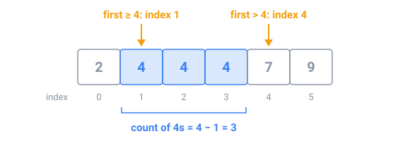

## In short

Time limits turn Big O into a budget. A computer does roughly **10⁸ simple steps per second**, so read the input limits before writing code: with n up to 200,000, a loop over all pairs is 4 × 10¹⁰ steps (minutes), while O(n log n) is about 3.5 million (milliseconds). As a rule of thumb, n ≤ 5,000 allows O(n²), and n ≤ 500,000 needs O(n log n) or better.

Most fixes replace a **nested loop** with a better tool:

- **A hash set** answers "have I seen this before?" in constant time on average.
- **Sorting** puts equal or close values side by side, so one pass compares neighbours.
- **Two pointers** walk a sorted array from both ends, or as the start and end of a window, each moving one way only.

**Binary search** does more than find one value. In sorted data it finds **boundaries**, such as the first index whose value is ≥ x, and two boundaries count everything in a range:

It can also search for an **answer**: when "does c work?" is no up to some value and yes from there on, binary search finds that first yes in about 30 checks, even between 1 and 10⁹.

The usual bug is being off by one: decide whether `hi` is the last index or one past it, and keep that choice everywhere.

<!-- readings -->

## Check yourself

1. With n ≤ 100,000, does an O(n²) solution fit a one-second limit?
2. In `2 4 4 4 7 9`, what is the first index with a value ≥ 5?
3. Why can you binary-search the smallest truck capacity that works, when no array holds the capacities?
