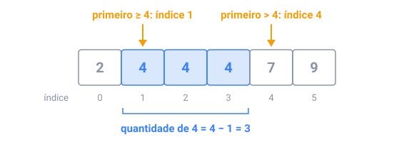

## Em resumo

Limites de tempo transformam o Big O num orçamento. Um computador faz mais ou menos **10⁸ passos simples por segundo**, então leia os limites da entrada antes de escrever código: com n até 200.000, um laço sobre todos os pares dá 4 × 10¹⁰ passos (minutos), enquanto O(n log n) dá uns 3,5 milhões (milissegundos). Como regra prática, n ≤ 5.000 permite O(n²), e n ≤ 500.000 pede O(n log n) ou melhor.

A maioria das correções troca um **laço aninhado** por uma ferramenta melhor:

- **Um conjunto de hash** responde "já vi isto antes?" em tempo constante, em média.
- **Ordenar** coloca valores iguais ou próximos lado a lado, e uma passada compara vizinhos.
- **Dois ponteiros** percorrem um array ordenado pelas duas pontas, ou como início e fim de uma janela, cada um andando num só sentido.

A **busca binária** faz mais que achar um valor. Em dados ordenados ela acha **fronteiras**, como o primeiro índice com valor ≥ x, e duas fronteiras contam tudo o que está num intervalo:

Ela também busca uma **resposta**: quando "c funciona?" é não até certo valor e sim dali em diante, a busca binária acha o primeiro sim em uns 30 testes, mesmo entre 1 e 10⁹.

O erro mais comum é errar por um: decida se `hi` é o último índice ou um depois dele, e mantenha essa escolha em todo lugar.

<!-- readings -->

## Verifique

1. Com n ≤ 100.000, uma solução O(n²) cabe num limite de um segundo?
2. Em `2 4 4 4 7 9`, qual é o primeiro índice com valor ≥ 5?
3. Por que dá para fazer busca binária na menor capacidade de caminhão que funciona, se nenhum array guarda as capacidades?
