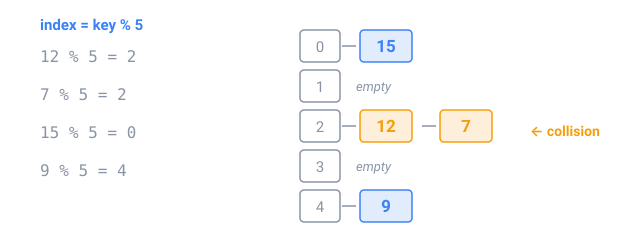

## In short

A **hash table** finds a key in about the same time however many keys it holds. A **hash function** turns the key into a number, its **hash code**, and the table uses it to choose a **bucket**, such as `index = hash % buckets`.

Two keys can land in the same bucket: a **collision**. Each bucket keeps a short list (separate chaining), or the table tries the next free slot (open addressing). When the table gets too full it doubles its buckets and reinserts everything, which keeps the lists short: O(1) per operation on average.

In Java, `HashMap` and `HashSet` are hash tables. They call the key's `hashCode()` to find the bucket and `equals()` to compare inside it, so the two must agree, and a key must not change while it is in the map.

Hash tables replace nested loops that ask "have I seen this?" or "how many?":

- **Counting:** `counts.merge(key, 1, Integer::sum)`.
- **Grouping** by a chosen key: words with the same sorted letters are anagrams.
- **Prefix sums:** the sum of `a[i..j]` is `prefix[j + 1] − prefix[i]`, so a map of the prefix sums seen so far finds every range with a given sum in one pass.

Watch out: a hash function that sends many keys to one bucket turns the table into a slow list.

<!-- readings -->

## Check yourself

1. Why does a HashMap stay fast after a million insertions?
2. What key puts "listen", "silent" and "enlist" in the same group?
3. In `3 4 -1 2`, which range sums to 6?
