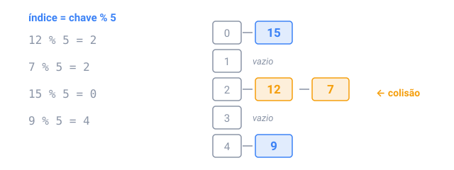

## Em resumo

Uma **tabela hash** acha uma chave mais ou menos no mesmo tempo, seja quantas chaves ela guardar. Uma **função hash** transforma a chave num número, seu **código hash**, e a tabela o usa para escolher um **balde**, como `índice = hash % baldes`.

Duas chaves podem cair no mesmo balde: uma **colisão**. Cada balde guarda uma lista curta (encadeamento separado), ou a tabela tenta a próxima posição livre (endereçamento aberto). Quando a tabela fica cheia demais, ela dobra os baldes e reinsere tudo, o que mantém as listas curtas: O(1) por operação, em média.

Em Java, `HashMap` e `HashSet` são tabelas hash. Eles chamam o `hashCode()` da chave para achar o balde e o `equals()` para comparar dentro dele, então os dois precisam concordar, e uma chave não pode mudar enquanto está no mapa.

Tabelas hash substituem laços aninhados que perguntam "já vi isto?" ou "quantos?":

- **Contar:** `counts.merge(chave, 1, Integer::sum)`.
- **Agrupar** por uma chave escolhida: palavras com as mesmas letras ordenadas são anagramas.
- **Somas de prefixo:** a soma de `a[i..j]` é `prefix[j + 1] − prefix[i]`, então um mapa das somas de prefixo vistas até agora acha todo intervalo com uma soma dada numa passada.

Cuidado: uma função hash que manda muitas chaves para o mesmo balde transforma a tabela numa lista lenta.

<!-- readings -->

## Verifique

1. Por que um HashMap continua rápido depois de um milhão de inserções?
2. Que chave coloca "listen", "silent" e "enlist" no mesmo grupo?
3. Em `3 4 -1 2`, qual intervalo soma 6?
