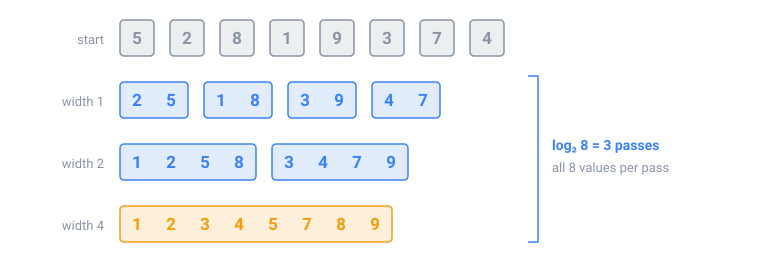

## In short

Sorting makes data easy to search, group and compare, and the main O(n log n) sorts use one of two ideas.

**Merge sort** merges sorted runs. Merging two sorted lists takes one comparison per value taken, so a pass over n values costs about n. Start with runs of 1 and double their size every pass: after log₂ n passes there is one sorted run, for O(n log n) in total, always.

**Quicksort** picks a pivot, moves smaller values to its left and bigger ones to its right (a **partition**), then sorts each side. It is O(n log n) on average, but a bad pivot every time, such as the first element of a sorted array, makes it O(n²).

When the values are small whole numbers, such as scores from 0 to 100, **counting sort** doesn't compare at all: it counts how often each value appears, in O(n + k) for k possible values.

In Java, `Arrays.sort` on an `int[]` uses a quicksort, and on objects a merge sort driven by a **comparator**, such as `Comparator.comparingInt(Meeting::start)`. That sort is **stable**: equal elements keep their order.

Watch out: a comparator written as `a - b` can overflow. Use `Integer.compare(a, b)`.

<!-- readings -->

## Check yourself

1. How many passes does bottom-up merge sort make on 1,000 values?
2. Why can't counting sort sort names?
3. What does a stable sort keep, and when does that matter?
