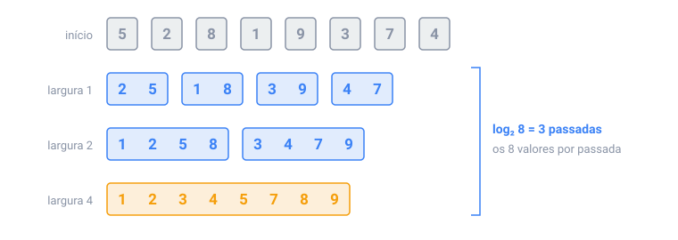

## Em resumo

Ordenar deixa os dados fáceis de buscar, agrupar e comparar, e as principais ordenações O(n log n) usam uma de duas ideias.

O **merge sort** intercala sequências ordenadas. Intercalar duas listas ordenadas custa uma comparação por valor retirado, então uma passada por n valores custa uns n. Comece com sequências de 1 e dobre o tamanho a cada passada: depois de log₂ n passadas sobra uma sequência ordenada, com O(n log n) no total, sempre.

O **quicksort** escolhe um pivô, move os valores menores para a esquerda dele e os maiores para a direita (uma **partição**), e ordena cada lado. Ele é O(n log n) em média, mas um pivô ruim toda vez, como o primeiro elemento de um array ordenado, o deixa O(n²).

Quando os valores são inteiros pequenos, como notas de 0 a 100, a **ordenação por contagem** nem compara: ela conta quantas vezes cada valor aparece, em O(n + k) para k valores possíveis.

Em Java, `Arrays.sort` num `int[]` usa um quicksort, e em objetos um merge sort guiado por um **comparator**, como `Comparator.comparingInt(Meeting::start)`. Essa ordenação é **estável**: elementos iguais mantêm a ordem em que estavam.

Cuidado: um comparator escrito como `a - b` pode estourar. Use `Integer.compare(a, b)`.

<!-- readings -->

## Verifique

1. Quantas passadas o merge sort de baixo para cima faz em 1.000 valores?
2. Por que a ordenação por contagem não ordena nomes?
3. O que uma ordenação estável mantém, e quando isso importa?
