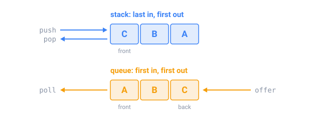

## In short

A **stack** gives back the last value put in (last in, first out): undo history, a browser's Back button, matching brackets, the method calls of a running program. A **queue** gives back the first (first in, first out): print jobs, a CPU taking turns between programs, messages waiting to be handled.

In Java, `ArrayDeque` is both. As a stack: `push`, `pop` and `peek`. As a queue: `offer`, `poll` and `peek`. Every operation is O(1).

Two patterns turn O(n²) loops into O(n):

- A **monotonic stack** keeps its values in decreasing order. When a bigger value arrives, it pops every smaller one, and each popped value has just found its next bigger value. Every value is pushed once and popped at most once, so the loop inside the loop costs O(n) in total.
- A **monotonic deque** does the same for a sliding window: its front is the window's maximum, values that can never be the maximum again leave from the back, and values that leave the window leave from the front.

Two stacks, one for numbers and one for operators, also evaluate expressions like `2 + 3 * 4` with the right precedence.

Watch out: `pop()` on an empty `ArrayDeque` throws an exception, while `poll()` returns `null`.

<!-- readings -->

## Check yourself

1. Which structure does a Back button need, and which a print queue?
2. Why is a monotonic stack O(n), although it has a loop inside a loop?
3. In `8 - 3 - 2`, which subtraction must be done first, and why?
