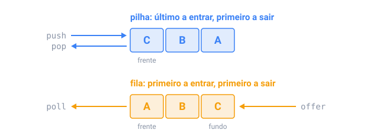

## Em resumo

Uma **pilha** devolve o último valor colocado (último a entrar, primeiro a sair): o histórico de desfazer, o botão Voltar do navegador, a conferência de parênteses, as chamadas de método de um programa rodando. Uma **fila** devolve o primeiro (primeiro a entrar, primeiro a sair): trabalhos de impressão, uma CPU revezando entre programas, mensagens esperando para ser tratadas.

Em Java, o `ArrayDeque` é as duas coisas. Como pilha: `push`, `pop` e `peek`. Como fila: `offer`, `poll` e `peek`. Toda operação é O(1).

Dois padrões transformam laços O(n²) em O(n):

- Uma **pilha monotônica** mantém seus valores em ordem decrescente. Quando chega um valor maior, ela desempilha todos os menores, e cada valor desempilhado acabou de achar seu próximo valor maior. Cada valor entra uma vez e sai no máximo uma vez, então o laço dentro do laço custa O(n) no total.
- Um **deque monotônico** faz o mesmo para uma janela deslizante: a frente dele é o máximo da janela, valores que nunca mais podem ser o máximo saem pelo fundo, e valores que saem da janela saem pela frente.

Duas pilhas, uma para números e outra para operadores, também calculam expressões como `2 + 3 * 4` com a precedência certa.

Cuidado: `pop()` num `ArrayDeque` vazio lança uma exceção, enquanto `poll()` devolve `null`.

<!-- readings -->

## Verifique

1. Que estrutura um botão Voltar precisa, e qual uma fila de impressão?
2. Por que uma pilha monotônica é O(n), mesmo tendo um laço dentro de outro?
3. Em `8 - 3 - 2`, qual subtração precisa ser feita primeiro, e por quê?
