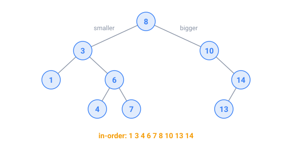

## In short

A **tree** is a hierarchy: one **root**, and every other node has exactly one **parent**. Org charts, folders, web pages and the expressions a compiler reads are trees. A node's **depth** is its distance from the root, and the tree's **height** is the depth of its deepest node. A tree can live in a **parent array** (`parent[i]`) or in **nodes** that point to their children.

A **binary search tree** (BST) keeps smaller keys on the left of every node and bigger keys on the right, so a search walks down a single path: O(height).

Random insertions give a height of about 2 log₂ n. Sorted insertions build a chain of height n: a slow linked list. That's why Java's `TreeMap` rebalances itself to stay O(log n).

Three **traversals** visit every node:

- **pre-order** (node, left, right) copies a tree;
- **in-order** (left, node, right) gives a BST's keys sorted;
- **post-order** (left, right, node) finishes the children first, which is how a folder adds up its contents.

A **trie** is a tree of letters: each path from the root spells a prefix, so counting the words that start with "car" takes three steps down.

Watch out: recursion on a deep, chain-shaped tree can overflow the call stack.

<!-- readings -->

## Check yourself

1. Which traversal prints a BST's keys in order?
2. What do you get by inserting 1, 2, 3, 4, 5 into an empty BST, and what is its height?
3. Why does a folder's size need a post-order traversal?
