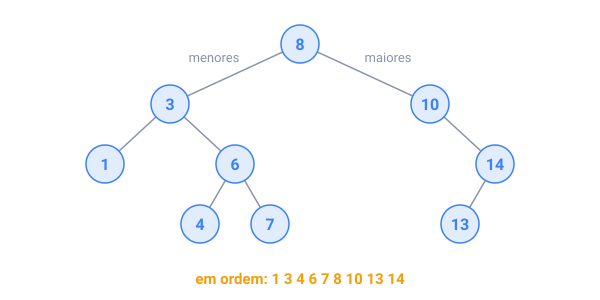

## Em resumo

Uma **árvore** é uma hierarquia: uma **raiz**, e todo outro nó tem exatamente um **pai**. Organogramas, pastas, páginas web e as expressões que um compilador lê são árvores. A **profundidade** de um nó é sua distância até a raiz, e a **altura** da árvore é a profundidade do nó mais fundo. Uma árvore pode morar num **array de pais** (`parent[i]`) ou em **nós** que apontam para os filhos.

Uma **árvore binária de busca** (BST) guarda as chaves menores à esquerda de cada nó e as maiores à direita, então uma busca desce por um caminho só: O(altura).

Inserções aleatórias dão uma altura de uns 2 log₂ n. Inserções em ordem constroem uma corrente de altura n: uma lista encadeada lenta. Por isso o `TreeMap` do Java se rebalanceia para continuar O(log n).

Três **percursos** visitam todos os nós:

- **pré-ordem** (nó, esquerda, direita) copia uma árvore;
- **em ordem** (esquerda, nó, direita) dá as chaves de uma BST ordenadas;
- **pós-ordem** (esquerda, direita, nó) termina os filhos primeiro, e é assim que uma pasta soma seu conteúdo.

Uma **trie** é uma árvore de letras: cada caminho a partir da raiz forma um prefixo, então contar as palavras que começam com "car" leva três passos para baixo.

Cuidado: recursão numa árvore funda, em forma de corrente, pode estourar a pilha de chamadas.

<!-- readings -->

## Verifique

1. Que percurso imprime as chaves de uma BST em ordem?
2. O que você obtém inserindo 1, 2, 3, 4, 5 numa BST vazia, e qual é a altura dela?
3. Por que o tamanho de uma pasta precisa de um percurso em pós-ordem?
